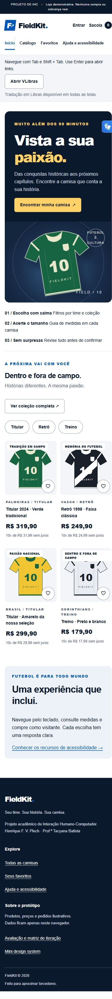

# FieldKit — registro de verificação

Execução: 22/10/2026. Ambiente: Windows, Node.js 24.18.0 e navegador integrado do aplicativo. Dados fictícios usados na compra: Pessoa Teste, teste@example.com, Rua Exemplo 10, Recife/PE. Os dados de teste foram limpos ao finalizar.

## Verificações automatizadas

| Comando                       | Resultado                                                                        |
| ----------------------------- | -------------------------------------------------------------------------------- |
| `node --check app.js`         | Sintaxe válida                                                                   |
| `node scripts/check.mjs`      | Nove grupos aprovados; dez telas geradas com um H1 por tela e sem IDs duplicados |
| Cálculo de contraste da suíte | Onze pares documentados de texto acima de 4,5:1                                  |

A suíte verifica busca com acentos, filtros combinados, ordenação/vazio, cupom por coleção, arredondamento em centavos, frete, validação de seis campos, guardas de rota, dados persistidos inválidos e escape de HTML. O DOM usado na suíte é mínimo e simulado: não valida a árvore de acessibilidade real.

## Verificações no navegador

| Cenário executado                   | Evidência observada                                                                             |
| ----------------------------------- | ----------------------------------------------------------------------------------------------- |
| Início → detalhes do Palmeiras      | Tela de produto, preço, tamanhos e guias disponíveis                                            |
| Adicionar sem tamanho               | Mensagem específica e foco no primeiro tamanho                                                  |
| Selecionar M e adicionar            | Sacola com tamanho M, uma unidade e contagem atualizada                                         |
| Cupom ERRADO                        | Erro “Cupom não reconhecido. Use FIELDKIT15.”                                                   |
| Cupom FIELDKIT15                    | R$ 319,90 − R$ 47,99 = R$ 271,91; frete grátis                                                  |
| Entrega vazia                       | Seis erros; foco no resumo e campos associados às mensagens                                     |
| Entrega fictícia completa → revisão | Nome, e-mail, endereço, tamanho e total exibidos para conferência                               |
| Confirmar                           | Botão desabilitado e “Concluindo simulação…”; depois sucesso, referência e total; sacola zerada |
| Busca “inexistente”                 | Zero resultados e ação para limpar filtros                                                      |
| Limpar filtros                      | Catálogo com seis produtos restaurado                                                           |
| Favoritar e recarregar              | Produto preservado em Favoritos; botão com estado pressionado                                   |
| Remover favorito                    | Lista atualizada e mensagem de remoção                                                          |
| Perfil vazio / preenchido           | Erro específico; nome fictício ativa perfil temporário                                          |
| Aumentar quantidade                 | Duas unidades, total R$ 639,80 e foco preservado no botão                                       |
| Remover e desfazer                  | Estado vazio com desfazer; restauração das duas unidades                                        |
| Ajuda e limpeza                     | FAQ disponível; ação limpa sacola, favoritos e perfil                                           |
| Teclado: Tab após recarregar        | Primeiro foco no link “Pular para o conteúdo”                                                   |
| Enter no skip link                  | Foco em `main#conteudo`; rota continua `#inicio`                                                |

## Responsividade e alvos

- Home: larguras de viewport de 320, 390 e 1280px sem overflow horizontal; `scrollWidth` observado de 305, 375 e 1265px respectivamente (diferença correspondente à barra de rolagem).
- Entrega: viewport de 390px com conteúdo de 375px, sem overflow horizontal.
- Botões medidos na home e entrega a 390px: nenhum abaixo de 44px em largura ou altura. Radios de tamanho têm label de 52 × 48px; quantidade e favorito são 44 × 44px pelo CSS.
- Inspeção visual da home em desktop e móvel, com evidências abaixo.

## Limites e verificações pendentes

- Não houve sessão com usuários, leitor de tela real, auditoria WCAG completa ou avaliação independente.
- Navegação completa exclusivamente por teclado, zoom real de 200%, cores forçadas e preferência de movimento reduzido ainda precisam de verificação manual dedicada.
- O script do VLibras agora carrega automaticamente e seu controle permanece na estrutura global. Abertura e fechamento do painel pelo teclado foram verificados; a qualidade linguística e a execução completa de traduções ainda precisam de avaliação.
- A inspeção visual e as medidas não cobrem todas as combinações de texto, tamanho, navegador e tecnologia assistiva.
- O protótipo não valida existência de CEP ou endereço e não se comunica com serviços de pagamento, entrega ou autenticação.

## Correções durante a verificação

Corrigidos um nome de função no mapa de rotas que impedia a renderização inicial, o tratamento do skip link para não virar uma rota e a reaplicação indevida da coleção ao filtrar uma rota de categoria. Os testes automatizados e o fluxo principal no navegador foram executados após essas correções.

## Revisão de acessibilidade e formatação

- HTML, CSS, JavaScript, scripts e documentação formatados com Prettier 3.9.10, com dois espaços. Configurações incluídas para preservar o padrão.
- Templates HTML identificados por uma função `html`; geração de cards, campos e itens de revisão dividida em funções menores para leitura.
- VLibras verificado com a integração oficial: carregamento automático, botão global, abertura por Enter, painel com controles e fechamento por Enter. O controle permaneceu disponível ao mudar de tela.
- Doze paradas consecutivas com Tab no catálogo alcançaram breadcrumb, busca, três seletores, aplicação/limpeza e links/favoritos dos produtos, todas com `:focus-visible` ativo.
- Nos detalhes, envio sem tamanho levou o foco ao primeiro radio; seta para a direita selecionou M e limpou o erro. Tab e Enter adicionaram a camisa à sacola.
- Na entrega, envio pelo teclado focou o resumo de erros. Tab e Enter no primeiro erro levaram ao campo Nome, preservando a rota de entrega.
- Os testes automatizados de dez telas e os contrastes foram repetidos após a formatação.

Referências: [integração oficial do VLibras](https://vlibras.gov.br/doc/widget/installation/webpageintegration.html) e [WCAG 2.0 no W3C](https://www.w3.org/WAI/WCAG20/quickref/).
